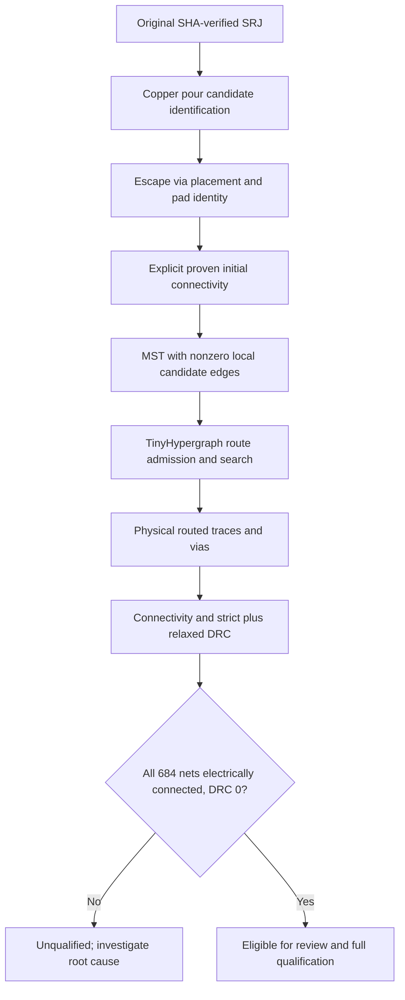

# #2868 — Source-verified local escape hints, MST result, and full-board negative control

Status: **experimental; not qualified for production merge**. Independent performance PRs #3774/#3775 and distinct-layer MST correctness PR #3784 remain separate.

## Source identity and boundary

Original public six-layer board JSON SHA-256:
`471334fad7b86e550ad1e5b9aae796665957512c78d6cc58f58fd2f8f11d28ca`.
Contains 684 source connections and 3,809 obstacles. GND `source_net_144` contains 730 original ports and its escape stage creates 680 pad-associated vias to `inner1`.

## Candidate

1. `EscapeViaLocationSolver` carries the chosen `sourcePointId` as a **non-electrical metadata hint** on the corresponding newly generated via terminal.
2. `NetToPointPairsSolver` includes a candidate MST edge between a via and its *own* source pad if the source ID is in that same logical connection, the fixed routing layer matches, the via has a different target layer, and the distance is finite and **strictly positive**.
3. The edge does not modify the initially-connected map, group nets, or bypass routing/DRC. Ordinary nearest-neighbor MST candidates remain available.

## Controlled MST-stage comparison

Both variants used the exact same escaped SRJ. Values are **candidate point-pair edges, not completed physical copper**.

| Metric | Main without hints | Source-pad anchor hints |
|---|---:|---:|
| GND escape vias | 680 | 680 |
| GND point-pair MST edges | 730 | 730 |
| Local own-pad-to-via edges chosen | 284 | 661 |
| GND MST edges >4 mm | 333 | 31 |
| Longest GND MST edge (mm) | 42.6085 | 39.1503 |

Use `SRJ_FILE=/absolute/path/scanner-full-board.simple-route.json bun scripts/repros/issue2868-audit-escape-anchors.ts` on the candidate and on main as a negative control. The script checks the original SHA before deriving via and MST data.

## Full-board A/B qualification: *negative result*

A combined #3774/#3775 test worktree with the local anchor proposal was executed against the unchanged original source attachment, using a bounded systemd scope, MemoryMax=11G, MemorySwapMax=0. Code base `fa7fe9202e45c747ae05a6c4b295c86f460e492e` plus the three-file proposal. Evidence log on the authorized server: `/root/tscircuit-work-20261114/issue-2868/anchor-verify/qualification.jsonl`.

- `solved=false`, `failed=true`: `PreparedPortPointRoutingSolver ran out of iterations`.
- 528.1 s, 8,321,271 Pipeline steps, 8,000,000 internal graph iterations, observed max RSS 6,371 MB.
- Failure moved from the baseline's `source_net_144_mst491` (GND, routeId 491) to **`source_net_558_mst6` (routeId 1209)**, from `pcb_port_127` at `(-2.9751,-34.1658)` top to `pcb_port_1370` at `(4.0249,-34.1658)` top.
- New failure snapshot: 1,394 queued routes, zero global selective rerips, one never-successful route attempt, graphRouteCount 2,604.
- This is **not** sufficient evidence of 1,210 successfully or electrically routed connections: route IDs and queue order can differ.
- No routed full-board output was qualified. No claim of zero DRC, cross-net shorts, or disconnected pads is made.

**Decision:** Local anchors improve the geometric spanning-tree topology, but alone do **not** resolve #2868. The search/route-admission behavior of `source_net_558_mst6` and other concurrent nets must be investigated before a root-cause resolution can be claimed. The two-terminal source-derived isolation fixture uses the same original physical obstacles for a narrower reachability check; it is **not** a replacement for original full-board acceptance.

## Data lineage and gate

No code can treat merely sharing a copper pour name, touching a source rectangle, or matching XY coordinates as demonstrated electrical connectivity. Existing plane regions may have cutouts/islands and must be verified after pour and trace geometry have been materialized.
