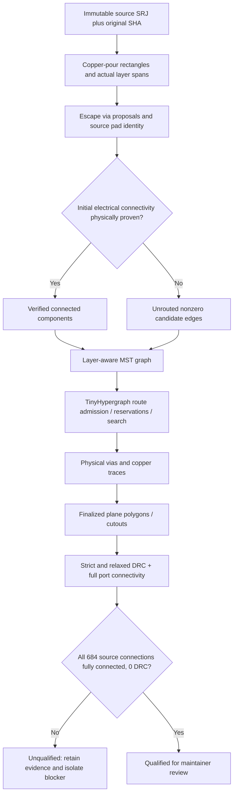

# #2868 — engineering handoff after exact-board and DRC-gated hypothesis tests

Date: 2026-11-14. **No full-board solution has qualified. No candidate here should close #2868.**

## Immutable provenance

The user-posted scanner attachment (`scanner-full-board.simple-route.json`) has SHA-256 `471334fad7b86e550ad1e5b9aae796665957512c78d6cc58f58fd2f8f11d28ca`, 684 source connections, 3,809 physical obstacle records and six layers. The exact local source is `/root/tscircuit-work-20261114/issue-2868/scanner-full-board.simple-route.json`. All full-board comparisons below use that source without edits. Separate reductions have explicitly different hashes and cannot qualify the whole board.

## Measured results and decisions

| Hypothesis and revision | Controlled positive result | Mandatory negative control | Decision |
|---|---|---|---|
| Performance PR #3774/#3775 | Measured local memory/topology preparation and spatial-query improvements | Original source still exhausts 8M graph iterations | Keep independent; not #2868 resolution |
| Pad-to-own-escape-via MST candidates (experimental commit `8bd9af7`) | GND local candidates 284→661; >4mm GND pairs 333→31; same 680 vias and 730 GND pair edges; typed tests pass | Entire exact board still fails at 8,321,271 Pipeline / 8M internal steps; new failed route `source_net_558_mst6`, route ID 1209 | **Reject as sole fix**; positive edges do not prove copper connectivity |
| Route 1209 source-derived isolation | Two top ports from `source_net_558` solve on unchanged 3,809 source obstacles and 6 layers; 0 default and relaxed DRC, 0 disconnected ports | Excludes all other routing requests and unused differential-pair metadata; not a full board | Competing route reservations/admission or sequencing requires evidence |
| Layer-distinct MST union (#3784, from parallel agent) | 13 co-located top/bottom-net groups correctly retain all source port IDs | Dataset srj18 sample 11 main: 92 initial/71 post-repair relaxed DRC; PR plus local layer-aware endpoint snap: ~188 initial/176 post-repair errors; 1 failing CI shard | **Merge blocker**. Valid vertical metal/via transition needed; preserving graph identity is necessary but insufficient |
| Additive stacked-terminal bridging, keeping old MST edge order | All 13 stacked-net source-derived topologies retain all source IDs | Dataset srj18 sample11 still crashes downstream with duplicate `pcb_port_16` for stacked local pair | Does not solve route stitching, nor manufacturing correctness |
| Blind blanket rejection of foreign copper pour on any via drilled layer | Red/green adversarial fixture: a through-hole via no longer crosses a foreign-net pour rectangle, and intentional blind via can still stop before it | Exact board loses **all** initially generated vias (GND 680→0); 7 existing pour-via regressions (10 pass, 1 skip, 7 fail); final pour polygons may support valid cutouts | **Reject for production**. Must distinguish reserved copper geometry from finalized poured shapes and their openings |

## Full-board route search forensic snapshot

The exact #2868 input with combined performance improvements + local escape anchors completed preparation and entered global path search, but `solved=false`, `failed=true`, `PreparedPortPointRoutingSolver ran out of iterations`, 528.1 seconds, sampled max RSS 6,371 MB, 1,394 routes still queued, 0 global selective rerips. Failed route ID 1209 was `source_net_558_mst6`, top `pcb_port_127` at (-2.9751, -34.1658) to top `pcb_port_1370` at (4.0249, -34.1658). Original baseline failed instead at GND `source_net_144_mst491`. The changed blocker suggests the local anchors alter routing order/topology, but neither route completion nor electric correctness follows from that alone. Evidence `/root/tscircuit-work-20261114/issue-2868/anchor-verify/qualification.jsonl`.

Isolated pair, all original obstacles preserved: derived SRJ SHA `ba7fde466d17743a711573f6d7bbd38f6861efc3672524f0373600452129e071`, 63.7s, 482,802 steps, `solved=true`, 0 strict/default and relaxed DRC, 0 disconnected ports, one source connection. Evidence `/root/tscircuit-work-20261114/issue-2868/anchor-verify/route1209-isolation/isolation-clean.jsonl`.

## Distinct-layer MST regression details

Source connection `source_net_13` on srj18 sample 11 contains two physically distinct PCB ports at identical XY (1.98, 3.77), `pcb_port_16` on top and `pcb_port_334` on bottom. The current `@tscircuit/math-utils.distance()` ignores `z` and returns 0 for this pair, so when Route Stitching selects endpoints with `preferSameLayerTerminalEndpoints=false`, it can snap the bottom endpoint to top port 16, causing the CI exception. Restricting this snap to same-layer for stacked coordinates removes the exception, but then reveals large DRC regression (verified by running the exact benchmark fixture on both revisions). After the exact repair phase:

| DRC class | Main | layer-distinct MST + snap |
|---|---:|---:|
| `pcb_trace_error` | 70 | 168 |
| `pcb_pad_pad_clearance_error` | 1 | 7 |
| `pcb_via_trace_clearance_error` | 0 | 1 |
| **Total** | **71** | **176** |

No test snapshots should be blindly updated. An additive appended interlayer edge preserves original MST geometry but also fails the downstream stitcher; the sound fix must represent *physical interlayer route intent*, not just zero-XY graph adjacency.

## Copper pour representation warning

On the exact original SRJ, a rectangular-overlap audit finds **680/680** generated `source_net_144` GND escape via disks intersect at least one `source_net_0` `inner4` copper-pour rectangle when considered as through-hole via drill-span obstructions; 675 centers directly fall inside such rectangles. The present `EscapeViaLocationSolver.getMinBlockingClearance()` skips copper-pour obstacles on layers other than the via **source layer**. This is not sufficient proof that 680 fabricated shorts exist: a copper pour can be regenerated with voids/cutouts around foreign-net vias; a bare source rectangle is not necessarily the final manufactured polygon. Blanket blocking these rectangles causes unacceptable regressions and removes all 680 escape vias from the source-derived candidate set. Verify final poured copper polygons, per-layer hole/annular/clearance geometry and via-to-plane contacts before any shortcuts or trimming.

## Pipeline, information losses and qualification

Open investigations, ranked by falsifiability: (1) annotate the exact full-board failed route's start/goal incident capacity regions, already-reserved net owners, and unavailable edges, comparing the successful isolated case; (2) design a valid interlayer transition contract (via geometry, drilling span, annular/clearance, and trace attachments) for stacked ports without changing unrelated MST edges; (3) track pour voiding or finalized polygons and prove no cross-net via short; (4) only after that run a complete original SHA-verified pipeline+DRC+connectivity qualification. Do not increase budget/weights as a substitute for a causal fix.

This note is a concurrent-agent handoff, not a production PR or claim of complete issue resolution.
