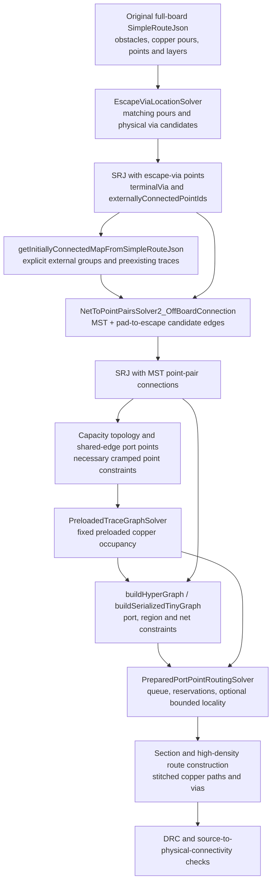

# #2868 — concrete SRJ-to-graph-to-copper data lineage and electrical proof boundary

**Evidence-oriented map, not an electrical completion claim.** Source: the actual Pipeline9 implementation and its referenced solvers, on the experimental integration branch. The original SRJ SHA-256 is `471334fad7b86e550ad1e5b9aae796665957512c78d6cc58fd2f8f11d28ca` (684 source connections, 3,809 obstacles, six layers). Any schematic conceptual arrow below indicates a software data transformation, not automatically a physical connection.

## Stage contracts and exactly where claims can be lost

| Stage | Relevant source code | Input → output | Important failure mode to test |
|---|---|---|---|
| Copper and escape | `EscapeViaLocationSolver.ts` | Pour and terminal geometry → candidate escape via points, `terminalVia` metadata and `externallyConnectedPointIds` grouped by `targetPourKey` | `targetPourKey` is based on obstacle ID or geometry: it **does not by itself prove** final physically connected poured polygons or keepout clearance |
| Declared pre-connections | `get-initially-connected-map-from-simple-route-json.ts` | Explicit point groups and traces → ConnectivityMap | Source *net names are intentionally excluded*; declared external groups are assertions from upstream, not fabricated PCB proof |
| MST decomposition | `NetToPointPairsSolver.ts`, `buildMinimumSpanningTree.ts` | Points plus path and true zero-weight connected edges and positive-weight local pad-to-escape hints → point-pair SRJ connections | A positive candidate edge is not a preexisting electrical connection; neither skip it as already connected nor treat every original MST route as independently mandatory without checking physical equivalence |
| Graph assembly | Pipeline9 `buildHyperGraph`, `TinyHypergraphPortPointPathingSolver.ts` | Topology, port points and serialized connections → region/port tiny-hypergraph graph | Reservation and layer constraints can increase cost or reject a valid edge; need exact per-route candidate measurements |
| Graph search | `PreparedPortPointRoutingSolver.ts` in `tiny-hypergraph` | Required graph route IDs → region assignments and graph paths | `solved=true` is only an internal graph condition. Route-scoped locality is an *optional*, bounded experiment with unrestricted fallback; it is not a global PCB proof |
| Copper output | Pipeline9 high density, stitching, trace construction and post-processing | Section paths → actual trace and via geometry | Traces may collide or fail to connect terminals even if graph says routed |
| Verification | Pipeline9 DRC/`@tscircuit/checks` and final connectivity audits | Physical output against original nets, traces, copper and layers → errors and connectivity | Zero by-name missing traces is not enough. Need zero default/strict and relaxed DRC **and** physical source-terminal connectivity for every source net; verify actual copper pours and via drill/annular clearance |

### Guardrail from independent foreign-pour analysis

Another independent experimental worktree (`experiment/2868-foreign-pour-via-clearance-20261114`) tested whether foreign pours on drilled layers must be excluded blindly. That **blanket guard failed** on the original board and existing regression cases. Source SRJ rectangular pour obstacles may be reservations *before final repour*; no fabricated shorts may be asserted based on rectangles alone. The other experiment was correctly marked **not mergeable**. A valid solution needs finalized polygon fill/void geometry before claiming electrical short avoidance. This data-lineage map does not revive that rejected approach.

## Verification state

- The original baseline, the 2-expansion adaptive run and the 4-expansion adaptive run all exhausted **8,000,000** graph iterations. Full-board DRC **was not reached**.
- The best *observed* full-board graph-frontier result is 2 expansions, ending on route ID **1710**, with **893** still queued; 4 expansions end on **1674** with **929** queued. These numbers are graph progress only.
- Per-route read-only transition sampling is now available in the guarded `issue2868-qualify-adaptive.ts` script. It must produce evidence for candidate-growth/queue hotspots before another algorithmic rewrite.
- A one-pair control with all 3,809 original obstacles, six layers, 0 DRC errors and a matching output SHA-256 verifies that observation does not mutate that *reduced* PCB output. It does not qualify the full board.

**Engineering priority:** isolate graph-level candidate generation, local-window expansion overhead and full-graph fallback causes for the highest-cost routes; separately investigate the physical proof boundary for copper pour components. Do not conflate these mechanisms or write an unqualified `Fixes #2868` PR.
